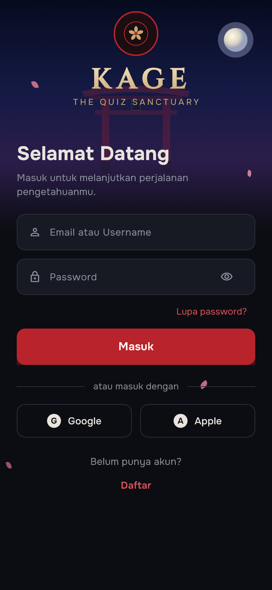
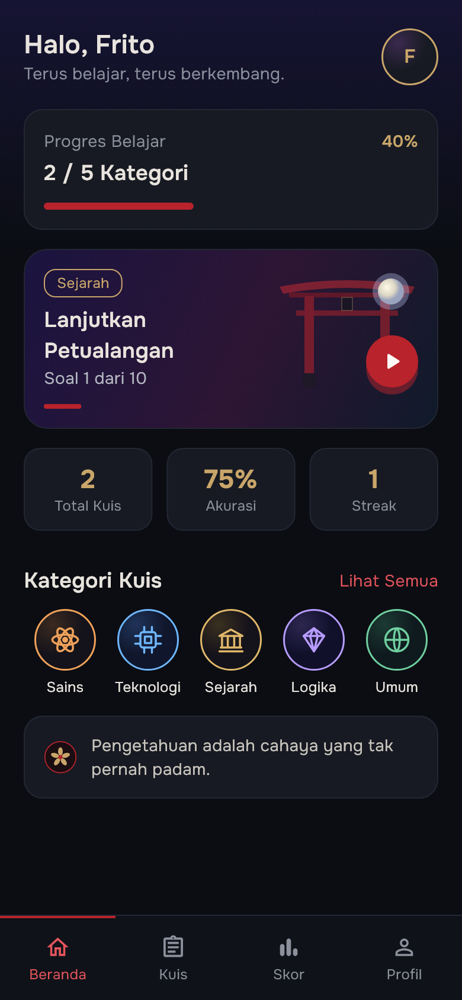
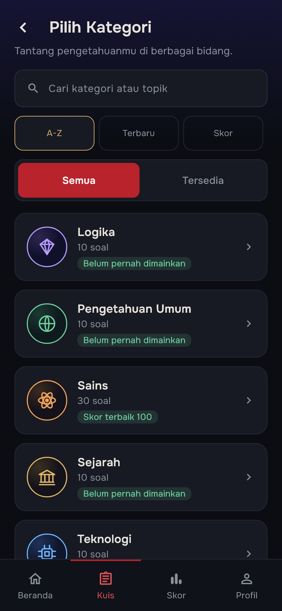
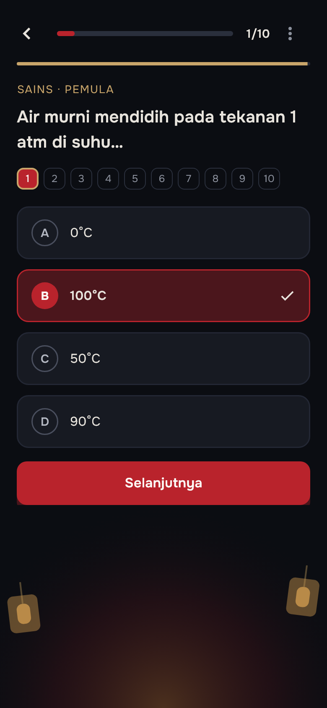
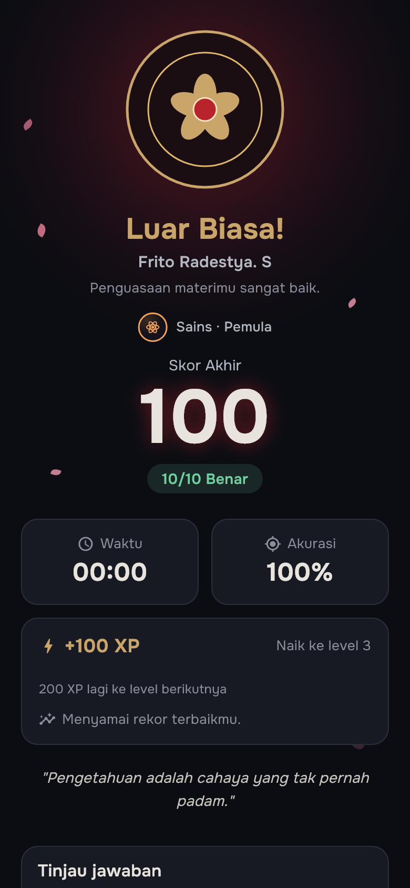
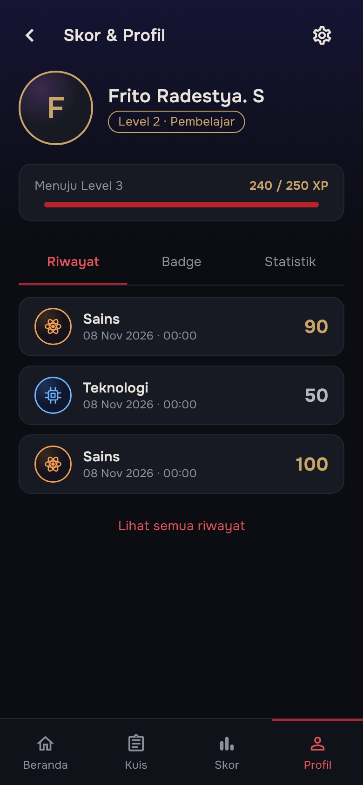

<div align="center">


# KAGE

### The Quiz Sanctuary

Aplikasi kuis pilihan ganda bertema kuil Jepang, dibangun dengan Flutter
untuk UTS Lab Pemrograman Mobile.

[](https://flutter.dev)
[](https://dart.dev)
[](#menjalankan-aplikasi)
[](https://github.com/Frito-Radestya/UTS-LAB-5-Pemrograman-Mobile-/actions/workflows/ci.yml)

</div>

---

## 1. Identitas Mahasiswa

| Informasi | Detail |
|---|---|
| **Nama** | Frito Radestya. S |
| **NIM** | 241401030 |
| **Lab** | 5 Pemrograman Mobile |

---

## 2. Informasi Aplikasi

### Nama Aplikasi
**KAGE — The Quiz Sanctuary**

### Deskripsi Singkat Aplikasi
**KAGE — The Quiz Sanctuary** adalah aplikasi kuis pilihan ganda interaktif yang mengajak pengguna menguji dan memperluas wawasan melalui perjalanan visual bernuansa kuil Jepang (*torii*, lentera, bulan, dan kelopak sakura). Pengguna dapat mendaftarkan/memasukkan nama dan akun, memilih kategori serta tingkat kesulitan, menjawab serangkaian pertanyaan pilihan ganda dengan timer per soal dan pembahasan mendalam, lalu melihat **skor akhir atas nama pengguna tersebut** beserta riwayat, progres XP/level, dan lencana pencapaian (*badge*).

Aplikasi berjalan sepenuhnya secara lokal di perangkat (tanpa membutuhkan database eksternal/backend) menggunakan penyimpanan lokal (`shared_preferences` dan `Hive`), mendukung **Dual-Theme (Mode Gelap & Mode Terang)**, serta dirancang **Adaptive & Responsive** untuk layar ponsel, tablet, maupun browser (Flutter Web).

### Fitur-Fitur yang Tersedia
- **Splash Screen Sinematik**: Animasi lentera berayun, kelopak sakura jatuh, dan layar pemuatan data (*bootstrap*).
- **Autentikasi & Identitas Pengguna Lokal**: Registrasi dan login dengan nama lengkap, email/username, dan kata sandi ter-hash PBKDF2-HMAC-SHA256, disertai validasi kekuatan password dan fitur edit profil.
- **Beranda Personal**: Menampilkan sapaan nama pengguna, progres belajar lintas kategori, kartu *Lanjutkan Petualangan* (resume kuis yang belum selesai), ringkasan statistik (Total Kuis, Akurasi, Streak harian), daftar kategori, dan kutipan.
- **5 Kategori Kuis & Pencarian/Filter**: Sains, Teknologi, Sejarah, Logika, dan Pengetahuan Umum, dilengkapi fitur pencarian nama/topik serta pengurutan kategori.
- **3 Tingkat Kesulitan & Timer per Soal**: Tingkat *Pemula* (30 dtk/soal, 1,0× XP), *Menengah* (25 dtk/soal, 1,5× XP), dan *Ahli* (20 dtk/soal, 2,0× XP) dengan pengacakan urutan soal dan opsi jawaban.
- **Kuis Interaktif & Pembahasan Jawaban**: Indikator nomor soal, bilah progres waktu & soal, penguncian jawaban setelah dikirim, serta halaman penjelasan lengkap berisi perbandingan jawaban pengguna vs jawaban benar dan *Fakta Menarik*.
- **Halaman Hasil Kuis Atas Nama Pengguna**: Menampilkan nama pengguna, animasi skor akhir (0–100), jumlah benar, durasi pengerjaan, akurasi, perolehan XP/kenaikan level, perbandingan dengan rekor terbaik, tinjauan seluruh soal, dan tombol **Ulangi Soal yang Salah**.
- **Riwayat Skor, Grafik Tren, & Detail Percobaan**: Filter riwayat berdasarkan kategori, tingkat kesulitan, dan rentang waktu (7/30 hari), grafik batang tren 10 percobaan terakhir, serta ekspor riwayat.
- **Sistem Level, XP, & Badge Pencapaian**: Kurva level kumulatif dan 5 lencana pencapaian (*First Quiz*, *Perfect 10*, *Streak 7*, *Explorer*, *Quiz Master*).
- **Dual-Theme (Dark & Light Mode)**: Mendukung tema **Gelap**, **Terang**, dan **Sistem** (mengikuti mode perangkat) dengan rasio kontras teks memenuhi standar aksesibilitas WCAG 2.1 ≥ 4,5:1.
- **Adaptive & Responsive Design**: Tata letak proporsional yang menyesuaikan ukuran layar ponsel secara dinamis (tanpa overflow pada rotasi maupun skala font hingga 2,0×) serta bingkai terpusat 520 px untuk tablet dan web browser.
- **Pengaturan Lengkap**: Pengaturan tema (Gelap/Terang/Sistem), bahasa (Indonesia/Inggris), efek suara, getaran (*haptics*), timer per soal, pengingat belajar harian, bantuan FAQ, dan hapus semua data lokal.

---

## 3. Dokumentasi

### a. Credit & Sumber Aset yang Digunakan
1. **Font Kustom (`assets/fonts/`)**:
   - **Onest** (*Regular, Medium, SemiBold, Bold*) — Google Fonts / Dmitrii Chirkov & Andrey Kudryavtsev, berlisensi [SIL Open Font License 1.1](assets/fonts/OFL.txt).
   - **Cinzel** (*SemiBold*) — Google Fonts / Natanael Gama, berlisensi [SIL Open Font License 1.1](assets/fonts/OFL.txt).
2. **Aset Vektor & Ilustrasi (`assets/svg/`)**:
   - Ilustrasi SVG orisinal yang dirancang khusus untuk tema kuil KAGE: `logo_emblem.svg`, `torii.svg`, `astrolab.svg`, ikon kategori (`icon_sains.svg`, `icon_teknologi.svg`, `icon_sejarah.svg`, `icon_logika.svg`, `icon_umum.svg`), serta lencana pencapaian (`badge_first_quiz.svg`, `badge_perfect_10.svg`, `badge_streak_7.svg`, `badge_explorer.svg`, `badge_master_locked.svg`).
3. **Ikon Antarmuka**:
   - **Material Icons** & **Cupertino Icons** bawaan ekosistem Flutter.
4. **Pustaka Open-Source (`pubspec.yaml`)**:
   - `provider` (State Management), `go_router` (Navigasi Deklaratif), `flutter_svg` (Render SVG), `shared_preferences` & `hive` / `hive_flutter` (Penyimpanan Lokal), `flutter_local_notifications` (Pengingat Belajar).

### b. Link Mockup / Prototype Aplikasi
- **Spesifikasi Desain & Mockup Interaktif (HTML/Canvas)**: Tersedia langsung di repositori pada folder [`docs/kage_package/`](docs/kage_package/):
  - Dokumen Spesifikasi Desain UI/UX: [`docs/KAGE_DESIGN_SPEC.md`](docs/KAGE_DESIGN_SPEC.md)
  - File Kanvas Prototype Desain: [`docs/kage_package/design_source/canvas.json`](docs/kage_package/design_source/canvas.json)
  - Mockup Layar HTML (`design_source/`):
    - [Main / Splash (`Main.dc.html`)](docs/kage_package/design_source/Main.dc.html)
    - [Login (`Login.dc.html`)](docs/kage_package/design_source/Login.dc.html) & [Register (`Register.dc.html`)](docs/kage_package/design_source/Register.dc.html)
    - [Beranda (`Beranda.dc.html`)](docs/kage_package/design_source/Beranda.dc.html)
    - [Daftar Kategori (`Kategori.dc.html`)](docs/kage_package/design_source/Kategori.dc.html) & [Detail Kategori (`DetailKategori.dc.html`)](docs/kage_package/design_source/DetailKategori.dc.html)
    - [Kuis (`Kuis.dc.html`)](docs/kage_package/design_source/Kuis.dc.html) & [Penjelasan (`Penjelasan.dc.html`)](docs/kage_package/design_source/Penjelasan.dc.html)
    - [Hasil Kuis (`Hasil.dc.html`)](docs/kage_package/design_source/Hasil.dc.html)
    - [Riwayat (`Riwayat.dc.html`)](docs/kage_package/design_source/Riwayat.dc.html), [Profil (`Profil.dc.html`)](docs/kage_package/design_source/Profil.dc.html), [Badge (`Badge.dc.html`)](docs/kage_package/design_source/Badge.dc.html), & [Pengaturan (`Pengaturan.dc.html`)](docs/kage_package/design_source/Pengaturan.dc.html)
    - [Design System (`DesignSystem.dc.html`)](docs/kage_package/design_source/DesignSystem.dc.html)

### c. Screenshot Tiap Page Aplikasi

<div align="center">

| Halaman Login | Halaman Beranda | Halaman Kategori |
|:---:|:---:|:---:|
|  |  |  |

| Halaman Kuis | Halaman Hasil Kuis | Halaman Profil |
|:---:|:---:|:---:|
|  |  |  |

</div>

Tangkapan layar diambil dari build web pada viewport ponsel 390 × 844.

## Alur Aplikasi

```text
Splash
  └── Login ──> Register
        └── Beranda ──> Kategori ──> Detail Kategori
              │                          └── Kuis ──> Penjelasan
              │                                        └── Hasil
              ├── Riwayat (filter & statistik)
              ├── Profil ──> Badge
              │          └── Pengaturan
              └── Lanjutkan Petualangan ──> Kuis
```

## Teknologi

| Kebutuhan | Implementasi |
|---|---|
| Framework | Flutter 3.47 / Dart 3.13 |
| Navigasi | [`go_router`](https://pub.dev/packages/go_router) 18.x |
| State management | [`provider`](https://pub.dev/packages/provider) 6.x (`ChangeNotifier`) |
| Aset vektor | [`flutter_svg`](https://pub.dev/packages/flutter_svg) 2.x |
| Penyimpanan ringan | [`shared_preferences`](https://pub.dev/packages/shared_preferences) 2.5 (sesi & pengaturan) |
| Basis data lokal | [`hive`](https://pub.dev/packages/hive) 2.2 + `hive_flutter` 1.1 (riwayat, XP, resume) |
| Tipografi | Font lokal **Onest** & **Cinzel** (`assets/fonts/`) |
| Ikon | Material Icons + aset SVG khusus KAGE |

### Palet Warna (Dual-Theme: Gelap & Terang)

| Token | Mode Gelap | Mode Terang | Penggunaan |
|---|---|---|---|
| Primary / Vermilion | `#B9232C` | `#B9232C` | Tombol utama, jawaban terpilih, progress bar |
| Background | `#0B0D12` (Midnight) | `#F7F3EB` (Warm Ivory) | Latar utama halaman |
| Surface | `#171A22` (Charcoal) | `#FFFFFF` (Pure White) | Kartu, input, panel |
| Gold | `#C9A56A` (Antique Gold) | `#7A5618` (Warm Bronze) | Aksen, badge, ornamen, level |
| Text | `#E8E4DD` (Ivory) | `#1C1917` (Ink Dark) | Teks utama |
| Muted | `#8B909C` | `#5C554C` | Teks sekunder dan metadata |

Warna aksen kategori menyesuaikan mode tema agar selalu memenuhi kontras WCAG ≥ 4,5:1:
- **Gelap**: Sains `#F0A25A`, Teknologi `#6EB6FF`, Sejarah `#E0B86A`, Logika `#B79CFF`, Umum `#6FD0A0`.
- **Terang**: Sains `#8C4A0E`, Teknologi `#1D5699`, Sejarah `#7A5618`, Logika `#563999`, Umum `#176B45`.

## Struktur Proyek

```text
lib/
├── main.dart                       # Entry point
├── app.dart                        # MaterialApp.router, GoRouter, responsive frame
├── app_services.dart               # Komposisi controller + penghubung hasil kuis
├── data/
│   ├── quiz_data.dart              # Metadata tampilan kategori (nama, warna, ikon)
│   ├── quiz_bank.dart              # Parser + validator bank soal JSON
│   ├── local/
│   │   ├── local_box.dart          # Pembuka kotak Hive (riwayat, XP, resume)
│   │   └── quiz_codec.dart         # Encode/decode JSON model kuis
│   └── repositories/
│       ├── quiz_repository.dart     # Kontrak bank soal + implementasi lokal
│       ├── auth_repository.dart     # Kontrak sesi + in-memory + shared_preferences
│       ├── history_repository.dart  # Kontrak riwayat + in-memory + Hive
│       ├── progress_repository.dart # Kontrak XP & resume + in-memory + Hive
│       └── settings_repository.dart # Kontrak preferensi + shared_preferences
├── models/
│   └── models.dart                 # CategoryId, Difficulty, Question, QuizResult, BadgeItem
├── features/
│   ├── auth/
│   │   ├── auth_controller.dart    # Sesi, identitas, dan profil pengguna
│   │   ├── login_page.dart
│   │   └── register_page.dart
│   ├── quiz/
│   │   ├── quiz_controller.dart    # Sesi kuis, jawaban, penguncian, resume
│   │   ├── kategori_page.dart
│   │   ├── detail_kategori_page.dart
│   │   ├── kuis_page.dart
│   │   ├── penjelasan_page.dart
│   │   └── hasil_page.dart
│   ├── history/
│   │   ├── history_controller.dart # Riwayat, statistik, dan badge
│   │   ├── streak.dart             # Perhitungan streak harian
│   │   ├── riwayat_page.dart
│   │   └── badge_page.dart
│   ├── home/
│   │   └── beranda_page.dart
│   ├── profile/
│   │   ├── progress_controller.dart # XP dan level
│   │   ├── progress.dart           # Kurva XP murni
│   │   └── profil_page.dart
│   ├── settings/
│   │   ├── settings_controller.dart # Preferensi aplikasi
│   │   └── pengaturan_page.dart
│   └── splash/
│       └── splash_page.dart
├── theme/
│   ├── app_colors.dart             # Token warna
│   └── app_theme.dart              # Onest, Cinzel, ThemeData
└── widgets/
    ├── kage_widgets.dart           # Barrel export untuk seluruh widget reusable
    ├── kage_wordmark.dart
    ├── sakura_petal.dart
    ├── moon_glow.dart
    ├── lantern.dart
    ├── star_field.dart
    ├── clippers.dart
    ├── torii_art.dart
    ├── emblem_mark.dart
    ├── category_icon_badge.dart
    ├── primary_button.dart
    ├── outline_button.dart
    ├── app_text_field.dart
    ├── kage_progress_bar.dart
    ├── back_icon_button.dart
    ├── score_row.dart
    ├── kage_bottom_nav.dart
    ├── top_wash.dart
    └── screen_scaffold.dart
```

Aset visual berada di `assets/svg/` dan font di `assets/fonts/`. Paket desain asli
(spesifikasi dan sumber HTML) disimpan di `kage_package/` sebagai referensi.
Tangkapan layar untuk dokumentasi berada di `docs/screenshots/`.

State dipisahkan per tanggung jawab. `AuthController`, `QuizController`,
`HistoryController`, `ProgressController`, dan `SettingsController` masing-masing
memiliki `ChangeNotifier` sendiri. `AppServices` hanya menjadi titik komposisi:
ia menghubungkan hasil kuis ke riwayat dan XP tanpa membuat controller saling
mengenal. Halaman mengambil controller yang dibutuhkan lewat `provider`.

Folder `lib/features/` mengelompokkan controller dan halaman berdasarkan domain
(auth, quiz, history, home, profile, settings, splash). Kode yang dipakai lintas
fitur tetap berada di `models/`, `data/`, `theme/`, dan `widgets/`. Seluruh import
internal memakai `package:kage/...` agar pemindahan file tidak memutus jalur
relatif.

Setiap widget reusable memiliki file sendiri di `lib/widgets/`. Berkas
`kage_widgets.dart` dipertahankan sebagai barrel export agar halaman cukup
mengimpor satu jalur tanpa bergantung pada lokasi internal setiap komponen.

Akses data melewati repository. `QuizRepository` membungkus bank soal,
`AuthRepository` menyimpan identitas sesi, `HistoryRepository` menangani
penyimpanan riwayat, `ProgressRepository` menyimpan XP dan kuis tersimpan, serta
`SettingsRepository` menyimpan preferensi. Controller hanya bergantung pada
kontrak tersebut, sehingga sumber soal, autentikasi, atau media penyimpanan
dapat diganti tanpa mengubah logika fitur.

`AppServices.create()` menyiapkan penyimpanan permanen lalu memakai implementasi
lokal: `LocalAuthRepository` dan `LocalSettingsRepository` di atas
`shared_preferences`, serta `LocalHistoryRepository` dan
`LocalProgressRepository` di atas kotak Hive. Implementasi in-memory tetap tersedia
untuk pengujian dan menjadi nilai bawaan `AppServices()`.

Tipografi memakai gaya bernama di `AppTextStyles` (`displayLarge`, `titleLarge`,
`body`, `caption`, `label`, dan variannya). Halaman tidak lagi menulis ukuran,
tinggi baris, atau warna teks secara berulang; nilai dinamis seperti warna status
cukup diturunkan dengan `copyWith`.

## Rute Aplikasi

| Rute | Halaman |
|---|---|
| `/` | Splash |
| `/login` | Login |
| `/register` | Registrasi |
| `/beranda` | Beranda |
| `/kategori` | Daftar kategori |
| `/kategori/:id` | Detail kategori |
| `/kuis` | Pengerjaan kuis |
| `/penjelasan` | Pembahasan jawaban |
| `/hasil` | Hasil kuis |
| `/riwayat` | Riwayat skor |
| `/riwayat/detail` | Detail satu percobaan kuis |
| `/profil` | Profil & statistik |
| `/badge` | Badge & pencapaian |
| `/pengaturan` | Pengaturan |

## Menjalankan Aplikasi

Pastikan Flutter sudah terpasang dan berada di channel stable.

```bash
flutter pub get
flutter run
```

Menjalankan di browser:

```bash
flutter run -d chrome
```

Melihat perangkat yang tersedia:

```bash
flutter devices
flutter run -d <device-id>
```

> Font Onest dan Cinzel dibundel langsung sebagai aset aplikasi, sehingga tampilan
> tetap konsisten dan tidak memerlukan koneksi internet saat dijalankan.

## Pengujian & Analisis

```bash
flutter analyze
flutter test
```

Build web untuk produksi:

```bash
flutter build web --release
```

## Akun & Data

Autentikasi berjalan **sepenuhnya di perangkat**. Registrasi menyimpan akun
beserta kata sandinya, dan masuk memeriksa kredensial tersebut: kata sandi yang
salah atau akun yang tidak ada ditolak.

Kata sandi tidak pernah disimpan apa adanya. Setiap akun memakai salt acak
sendiri (16 byte) dan disimpan sebagai kunci turunan **PBKDF2-HMAC-SHA256**
(10.000 iterasi, 32 byte) — lihat `lib/data/local/password_hash.dart`.
Verifikasi memakai perbandingan waktu tetap, dan data akun yang rusak diabaikan
tanpa membuat aplikasi gagal dijalankan.

Aturan yang ditegakkan `AuthController`:

| Aturan | Pesan |
|---|---|
| Nama wajib diisi | Nama lengkap wajib diisi. |
| Format email | Format email belum valid. |
| Email unik (tanpa membedakan huruf besar/kecil) | Email sudah terdaftar. Silakan masuk. |
| Kata sandi minimal 8 karakter | Password minimal 8 karakter. |
| Kredensial salah | Email atau password salah. |

Masuk menerima email, atau nama lengkap bila hanya satu akun yang memakai nama
itu. Ganti kata sandi memerlukan kata sandi saat ini dan menolak kata sandi baru
yang sama dengan yang lama. Mengubah profil ikut memperbarui akun tersimpan
tanpa mengubah kata sandinya.

Sesi lama yang tersimpan tanpa akun (dari versi sebelum D-03) tetap dipulihkan
agar pengguna tidak terlempar keluar; akunnya akan dibuat kembali saat mendaftar
ulang.

Pembahasan lengkap ada di `test/state/auth_test.dart`.

Data disimpan **permanen di perangkat** dan dipulihkan sebelum aplikasi
dijalankan (`AppServices.create()` di `lib/main.dart`):

| Data | Penyimpanan | Keterangan |
|---|---|---|
| Akun terdaftar (nama, email, kata sandi ter-hash) | `shared_preferences` (`auth.accounts`) | Kata sandi hanya tersimpan sebagai salt + kunci turunan |
| Sesi login dan profil (nama, email) | `shared_preferences` | Restart aplikasi tetap dalam keadaan masuk sampai pengguna logout |
| Pengaturan (mis. notifikasi) | `shared_preferences` | Nilai awal dibaca `SettingsController` |
| Riwayat skor | Hive (`kage_local` → `history`) | Disimpan sebagai JSON; data rusak diabaikan |
| XP dan level | Hive (`kage_local` → `progress.xp`) | Level selalu diturunkan dari XP |
| Kuis yang sedang berjalan | Hive (`kage_local` → `progress.resume`) | Termasuk urutan soal/opsi, jawaban, soal terkunci, dan durasi |

Logout menghapus sesi tersimpan, tetapi riwayat, XP, dan kuis tersimpan tetap
ada agar progres belajar tidak hilang ketika pengguna masuk kembali.

Untuk mengosongkan semuanya, buka menu **Profil > Pengaturan > Hapus Semua Data**, yang akan menghapus akun, sesi, riwayat, XP, dan kuis tersimpan di perangkat ini.

Simulasi "menutup lalu membuka aplikasi" tercakup oleh
`test/data/persistence_test.dart`, yang menutup kotak Hive, membukanya kembali
dari berkas di disk, lalu membuat ulang seluruh controller.

## Bank Soal (JSON)

Soal tidak lagi ditulis di dalam kode. Setiap kategori punya satu berkas di
`assets/data/` yang dimuat saat aplikasi mulai (`AppServices.create()`):

```text
assets/data/questions_sains.json
assets/data/questions_teknologi.json
assets/data/questions_sejarah.json
assets/data/questions_logika.json
assets/data/questions_umum.json
```

Skema berkas bersifat **berversi** (`schemaVersion`) supaya perubahan struktur
di masa depan bisa ditolak dengan pesan yang jelas, bukan gagal diam-diam:

```json
{
  "schemaVersion": 1,
  "categoryId": "sains",
  "questions": [
    {
      "difficulty": "pemula",
      "prompt": "Apa nama planet yang dikenal sebagai Planet Merah?",
      "options": ["Jupiter", "Mars", "Venus", "Saturnus"],
      "correctIndex": 1,
      "explanation": "Mars …",
      "funFact": "Mars memiliki gunung tertinggi …"
    }
  ]
}
```

`difficulty` memakai nilai enum `Difficulty` (`pemula`, `menengah`, `ahli`).
Menambah soal cukup dengan menyunting berkas JSON; jumlah soal per tingkat di
halaman detail kategori ikut menyesuaikan sendiri.

Parser dan validator ada di `lib/data/quiz_bank.dart`:

- `validateQuizBank()` mengumpulkan **semua** temuan sekaligus: versi skema tidak
didukung, `categoryId` tidak cocok, daftar soal kosong, `prompt`/`explanation`/
`funFact` kosong, pilihan kurang dari dua atau ada yang kosong/duplikat,
`correctIndex` di luar rentang, dan soal duplikat.
- `parseQuizBank()` mengembalikan model `Question` dan melempar
`QuizBankFormatException` berisi nama berkas beserta temuan bila berkas tidak sah.

`test/data/quiz_bank_test.dart` memuat **seluruh** berkas JSON, memvalidasi tiap
soal, dan memastikan bank benar-benar terbaca lewat asset bundle aplikasi.

## Keadaan Kosong, Memuat, dan Gagal

`main.dart` menjalankan `KageBootstrap`, yang memuat sesi, riwayat, progres, dan
bank soal sambil menampilkan indikator "Menyiapkan data…" beserta rangka kartu.
Bila penyimpanan gagal dibuka, layar menampilkan pesan beserta tombol **Coba
Lagi** alih-alih diam di layar kosong.

Keadaan kosong lain juga dibuat eksplisit: akun baru melihat kartu "Mulai kuis
pertamamu" di Beranda (bukan kartu progres 0/5), Riwayat kosong memakai
ilustrasi kuil `torii.svg` dengan ajakan dan tombol mulai, badge terkunci
menyebut syarat serta progresnya ("3/5 kategori"), dan halaman Hasil yang dibuka
tanpa kuis aktif menjelaskan keadaannya.

## Riwayat Kuis

Halaman Riwayat menyaring percobaan berdasarkan kategori, tingkat kesulitan
(`Semua tingkat` / `Pemula` / `Menengah` / `Ahli`), dan rentang waktu
(`Semua waktu` / `7 hari` / `30 hari`). Statistik di atas daftar mengikuti filter
aktif, dan grafik batang `Tren skor` menampilkan hingga sepuluh percobaan terakhir
dengan warna dari `scoreTint`.

Setiap entri bisa diketuk untuk membuka `/riwayat/detail`. Halaman itu
menampilkan ringkasan percobaan beserta tinjauan jawaban yang sama seperti
halaman Hasil. Karena bank soal tidak menyimpan jawaban pengguna, tiap
`QuizResult` menyimpan `answers`, `questionOrder`, dan `optionOrders`; helper
`reviewFromResult` menyusun ulang soal memakai urutan opsi yang benar-benar
dilihat pengguna saat itu. Bila rincian tidak ada atau tidak konsisten dengan bank
soal (riwayat versi lama, atau sesi latihan soal salah), halaman menampilkan pesan
"Rincian jawaban tidak tersedia" alih-alih pembahasan yang keliru.

## Level & XP

XP diperoleh sebesar skor akhir kuis. Level tidak disimpan sebagai angka
terpisah, melainkan selalu dihitung dari total XP melalui fungsi murni
`levelFromXp(int xp)` di `lib/features/profile/progress.dart`.

Kurva level bersifat kumulatif dan tidak memiliki batas level. Selisih XP yang
dibutuhkan bertambah 50 setiap level:

| Level | Total XP minimum | Selisih dari level sebelumnya |
|---|---|---|
| 1 | 0 | — |
| 2 | 100 | 100 |
| 3 | 250 | 150 |
| 4 | 450 | 200 |
| 5 | 700 | 250 |
| 6 | 1.000 | 300 |
| 7 | 1.350 | 350 |

Fungsi `xpToNextLevel(int xp)` mengembalikan sisa XP menuju level berikutnya dan
dipakai oleh bar progres di halaman Profil.

### Skor dan XP per Tingkat

Skor kuis selalu berupa persentase 0–100 dari jumlah jawaban benar. XP yang
didapat dihitung dari skor tersebut dengan pengali tingkat kesulitan:

| Tingkat | Pengali XP | Contoh skor 80 |
|---|---|---|
| Pemula | 1,0× | 80 XP |
| Menengah | 1,5× | 120 XP |
| Ahli | 2,0× | 160 XP |

Aturan ini didefinisikan pada `DifficultyX.xpMultiplier` di `lib/models/models.dart`
dan dipakai saat kuis selesai. Tingkat tanpa soal tidak dapat dipilih, sehingga
sesi kuis tidak pernah dimulai dengan bank soal kosong.

## Aksesibilitas

### Pembaca layar

Elemen interaktif memakai `KageTappable` yang membungkus `InkWell`, sehingga
semuanya berupa tombol bagi TalkBack/VoiceOver, bisa dijangkau dengan Tab, dan
aktif dengan Enter/Space di web. Teks yang dibacakan disesuaikan agar ringkas:

| Elemen | Yang dibacakan |
|---|---|
| Opsi jawaban | `Pilihan A. Oksigen`, ditambah `, terpilih` atau `, terkunci` |
| Bilah progres kuis | `Soal 3 dari 10` beserta persentasenya |
| Kartu kategori | `Kategori Sains, 30 soal, belum pernah dimainkan` |
| Tingkat kesulitan | `Tingkat Ahli, 10 soal` atau `… belum tersedia` |
| Badge | `First Quiz, Selesaikan kuis pertama, terbuka` / `terkunci` |
| Navigasi bawah | `Beranda, tab 1 dari 4, aktif` |
| Filter riwayat | `Filter Semua, aktif` |
| Tombol ikon | `Tampilkan password`, `Keluar dari kuis`, `Kembali ke daftar kategori` |

### Umpan balik jawaban

Halaman pembahasan menampilkan dua baris terpisah — `Jawabanmu` dan
`Jawaban benar` — lengkap dengan ikon dan penanda ✓/✗, sehingga perbedaannya
tidak bergantung pada warna saja dan tetap terbaca oleh pengguna dengan buta
warna. Getaran menyertai alurnya: ringan saat memilih opsi, sedang saat jawaban
benar, dan kuat saat jawaban salah. Getaran mengikuti preferensi di Pengaturan
(`SettingsController.haptics`) lewat helper `kageHaptic`.

### Area sentuh

Semua elemen interaktif minimal **48×48 dp**: tombol kembali, tombol mata pada
kolom password, chip filter riwayat, tab kategori, tingkat kesulitan, avatar,
tautan "Daftar"/"Masuk", opsi jawaban, dan item navigasi bawah. Uji otomatis
mengukurnya lewat `test/widgets/accessibility_test.dart`.

### Kontras

Rasio kontras dihitung dengan rumus WCAG 2.1 dan diperiksa otomatis di test:

| Warna teks | Di atas `#0B0D12` | Di atas `#171A22` |
|---|---|---|
| `text` #E8E4DD | 15,3:1 | 13,7:1 |
| `textSoft` #B4B8C2 | 9,8:1 | 8,8:1 |
| `textMuted` #8B909C | 6,1:1 | 5,4:1 |
| `textQuote` #C9C5BE | 11,3:1 | 10,1:1 |
| `primaryText` #E4545C | 5,3:1 | 4,7:1 |
| `gold` #C9A56A | 8,4:1 | 7,5:1 |

Semua token teks sudah di atas ambang 4,5:1 untuk teks kecil sehingga tidak ada
nilai yang perlu dinaikkan. Ikon `mutedIcon` #777C88 berada di 4,2:1 — di atas
ambang 3:1 yang berlaku untuk komponen non-teks.

### Skala font sistem

Ukuran teks terkecil adalah 12 sp (`captionSmall` dan `overlineGold` naik dari
11 sp). Tinggi tetap yang sebelumnya memotong teks diubah menjadi tinggi
minimum atau ukuran mengikuti isi pada header Beranda, kartu kategori, kontrol
tab kategori, dan state kosong riwayat. Seluruh halaman diuji pada skala 1,3×
dan 2,0× tanpa luber.

## Status Pengembangan

- [x] Splash, login, dan registrasi
- [x] Beranda dan navigasi utama
- [x] Kategori, detail kategori, dan pemilihan kesulitan
- [x] Kuis 50 soal, pembahasan, dan hasil
- [x] Riwayat skor dan statistik
- [x] Filter, tren skor, dan detail percobaan di Riwayat (U-11)
- [x] Keadaan kosong, memuat, dan gagal di seluruh alur utama (U-07)
- [x] Profil, badge, dan pengaturan
- [x] Responsif untuk web/tablet
- [x] Branding ikon, splash native, dan metadata web
- [x] Dual-theme: Mode Gelap, Mode Terang, dan Sistem (Bonus Poin 1)
- [x] Adaptive & Responsive Design untuk ponsel, tablet, dan web (Bonus Poin 2)
- [x] Penyimpanan permanen lokal (shared_preferences + Hive)
- [x] Bank soal dari aset JSON berversi + parser/validator (D-02)
- [x] Akun lokal dengan kata sandi ter-hash PBKDF2 (D-03 jalur A)

## Kontribusi

Proyek ini dibuat untuk keperluan UTS Lab Pemrograman Mobile. Saran dan perbaikan
dapat disampaikan melalui issue atau pull request di repositori ini.

---

<div align="center">

**KAGE — The Quiz Sanctuary**

*"Pengetahuan adalah cahaya yang tak pernah padam."*

</div>
